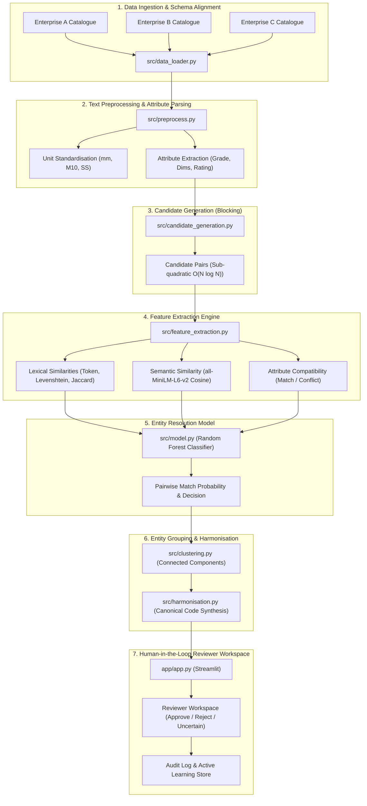

# System Architecture

## Overview
The Material Code Harmonisation platform is designed as a modular, tiered pipeline combining lexical preprocessing, candidate blocking, deep semantic embeddings, pairwise supervised classification, graph-based entity clustering, and a human-in-the-loop reviewer interface.

## Architectural Principles
1. **Modularity**: Core business and ML logic resides strictly in `src/`. Streamlit UI components and Jupyter notebooks import from `src/`.
2. **Sub-quadratic Scalability**: Pairwise comparison of $N$ items requires $O(N^2)$ checks without blocking. `candidate_generation.py` uses inverted TF-IDF / category blocking to prune unlikely pairs to $O(N \log N)$ or $O(K \cdot N)$.
3. **Evidence-Driven Decisions**: Rather than presenting an opaque prediction, the model outputs lexical overlap, semantic distance, and specific matching/conflicting attributes (e.g. diameter, material grade).
4. **Human Oversight**: High-confidence pairs can be auto-staged, but merges affecting master procurement records require human confirmation.
