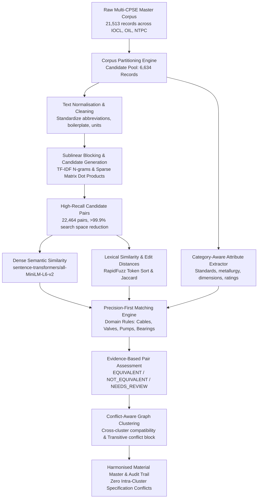

# Multi-Modal Entity Resolution Architecture Documentation

**Course:** CSE 276 – CA-1 Academic Project  
**Project:** Material Code Harmonisation Across Public Enterprises (IOCL, OIL, NTPC)  
**System Version:** 2.0 (Precision-First Hybrid Matching & Conflict-Aware Graph Clustering)  
**Status:** ✅ Hybrid self-supervised classifier trained (`models/hybrid_er_model.joblib`) — human-label training guard still active  

> **Update (6 Nov 2026) — Component 7: Hybrid Self-Supervised ER Model.**
> `src/synthetic_pairs.py` builds labelled-by-construction training pairs from the real candidate pool;
> `src/pair_features.py` computes 38 hybrid features (MiniLM, TF-IDF, fuzzy, canonical unit-aware
> specification conflicts, rule-engine signals); `src/model.py::HybridERModel` wraps the selected classifier
> with a precision-first three-way decision policy; `src/er_pipeline.py` trains, evaluates, scores all
> 22,464 candidate pairs and feeds `conflict_aware_clustering()`. Results: [`ml_model_report.md`](ml_model_report.md).

---

## 1. System Architecture Overview

The system addresses the challenge of harmonising disparate material masters across Indian Central Public Sector Enterprises (CPSEs) in the energy sector: Indian Oil Corporation Limited (IOCL), Oil India Limited (OIL), and NTPC Limited. 

Industrial procurement catalogues exhibit severe format heterogeneity:
- Unstandardized abbreviations (`SS` vs `STAINLESS STEEL`, `CS` vs `CARBON STEEL`).
- Diverse syntax (`BALL VALVE 2IN` vs `5. 1/2 INCH BALL VALVE-02 NOS`).
- Procurement boilerplate (`SUPPLY OF`, `PROCUREMENT PLAN FY2025-26`).
- Asymmetric engineering specifications across enterprises.

To achieve industrial reliability and avoid unsafe component substitution, the system implements a **multi-stage, precision-first entity resolution pipeline**:

---

## 2. Pipeline Components & Modules

### Component 1: Ingestion & Corpus Partitioning (`src/preprocessing/partition.py`)
- **Total Corpus:** 21,513 records across IOCL (3.6%), NTPC (8.3%), OIL (88.1%).
- **4-Tier Stratification:**
  - *Tier 1 (Discrete line items):* 923 records.
  - *Tier 2 Tagged (Commodity hint present):* 5,711 records.
  - *Tier 2 Untagged (Unclassified procurement):* 14,542 records.
  - *Tier 3 (Administrative contracts/services):* 337 records.
- **Candidate Pool:** 6,634 preprocessed material records (Tier 1 + Tier 2 Tagged) forming the operational scope for cross-enterprise harmonisation.

### Component 2: Normalisation & Attribute Extraction (`src/preprocessing/`)
- Uppercase conversion, punctuation stripping, unicode normalization.
- Engineering unit standardization (e.g., `10 mm`, `10-mm` $\rightarrow$ `10MM`; `1/2 "` $\rightarrow$ `1/2INCH`).
- Metallurgical synonym expansion (`SS` $\rightarrow$ `STAINLESS STEEL`, `CS` $\rightarrow$ `CARBON STEEL`).
- Removal of procurement boilerplate (`SUPPLY OF`, `PROCUREMENT OF`, `FOR USE IN`).
- Regex extraction of key physical parameters: metric thread, diameter, material grade, pressure class, schedule, voltage, and capacity.

### Component 3: Candidate Generation & Blocking (`src/candidate_generation.py`)
- Full pairwise comparison across 6,634 records requires $\approx 22.0 \times 10^6$ comparisons ($O(N^2)$), computationally intractable for dense transformers.
- **Sparse TF-IDF Retrieval:** Character and word n-grams (1, 2) with sublinear term-frequency scaling.
- Chunked sparse matrix dot product (`batch_size=500`) with cosine threshold $\tau = 0.35$.
- Enforces strict upper-triangular indexing ($i < j$) to eliminate self-matches and duplicate pair directions.
- Reduces search space by **>99.9%**, retrieving 22,464 candidate pairs (930 cross-enterprise pairs).

### Component 4: Multi-Modal Feature Extraction (`src/feature_extraction.py`)
- **Dense Semantic Embeddings:** Encodes descriptions using `sentence-transformers/all-MiniLM-L6-v2` (384 dimensions, float32, L2-normalized). Pairwise cosine similarity computed via dot product: $\text{sim}(u, v) = u \cdot v$.
- **Lexical Features:** RapidFuzz token sort ratio, token set ratio, character Levenshtein, and Jaccard token overlap.
- **Discrepancy Feature:** $\Delta = \text{Sim}_{\text{semantic}} - \text{Sim}_{\text{lexical}}$. High positive values identify cross-enterprise phrasing inversions and synonyms (e.g. `CENTRIFUGAL PUMP` vs `PUMP-CENTRIFUGAL`).
- **Target Leakage Safeguard:** Features strictly exclude database primary keys, tender numbers, URLs, enterprise labels, or ground-truth targets.

### Component 5: Precision-First Matching Engine (`src/matching_engine.py`)
Rather than relying purely on statistical similarity, the engine enforces domain-specific physical compatibility rules across 5 critical engineering categories:
1. **Cables & Electrical:** Compares voltage ($1.1\text{ kV}, 11\text{ kV}$), core count ($3\text{C}, 3.5\text{C}, 4\text{C}$), conductor size ($\text{mm}^2$), metallurgy (Copper vs Aluminium), insulation (XLPE vs PVC), and standards (IS:7098).
2. **Valves & Flow Control:** Compares valve type (Ball, Gate, Globe, Check, Butterfly), diameter/nominal bore, pressure class ($150\#, 300\#$), body material (SS304, SS316, WCB), end connection (Flanged, Threaded), and standards (API 6D).
3. **Pumps & Hydraulic Machinery:** Compares pump type (Centrifugal, Submersible, Reciprocating), flow rate, head, metallurgy, and standards (API 610).
4. **Bearings & Rotating Spares:** Compares ISO series (6205, 608), construction type (Deep groove, Spherical roller), and internal clearance (C2, C3).
5. **Instrumentation:** Compares measurement principle (Magnetic stirrer, Gas chromatograph, Pressure transmitter, Flowmeter) and accessories.

#### Output Decision Schema
Every candidate pair is classified into one of three states:
- `EQUIVALENT`: Zero conflicts, matching governing standards or identical functional ratings, and complete critical specifications.
- `NOT_EQUIVALENT`: Confirmed parameter conflict (e.g. 250MM vs 300MM diameter; 3C vs 4C cable; Ball vs Gate valve) or cross-category incompatibility.
- `NEEDS_REVIEW`: High semantic similarity but unstated or asymmetric critical specifications requiring SME verification.

### Component 6: Conflict-Aware Graph Clustering (`src/clustering.py`)
Standard connected-component clustering naively merges all nodes sharing a positive edge ($A \sim B$ and $B \sim C \implies \{A, B, C\}$), introducing catastrophic transitive errors.

**Safeguards implemented in `conflict_aware_clustering()`:**
1. **Cross-Product Compatibility Check:** Before merging cluster $C_1$ and cluster $C_2$, every pair $(x, y) \in C_1 \times C_2$ is validated against known conflict registers and domain rules.
2. **Transitive Conflict Detection:** If $A$ matches $B$ and $B$ matches $C$, but $A$ conflicts with $C$ (e.g. $B$ omitted a critical diameter specified in both $A$ and $C$), the merge of $C$ is **blocked**, and the transitive conflict is logged in the audit trail.
3. **Ambiguity Isolation:** Pairs flagged as `NEEDS_REVIEW` or `UNCERTAIN` are quarantined in singleton clusters, preventing unverified records from polluting established equivalence groups.

---

## 3. Human-in-the-Loop Review Architecture (`review_app.py`)

A zero-dependency HTTP application (`http.server`) enables human domain experts to inspect candidates and assign ground truth:
- **Dual-Dataset Review:** Dynamically toggles between Batch 1 (50 pairs) and Integrated Dataset (150 pairs).
- **Provenance Visibility:** Displays original material descriptions, normalized text, extracted physical attributes, tender IDs, and document URLs for both enterprises.
- **Specification Conflict Highlighting:** Surfaces highlighted banners for detected dimensional, metallurgical, or category clashes.
- **Segregated AI Advisory:** AI hypotheses and technical rationales are presented in a dedicated advisory panel with distinct visual styling, preventing bias while assisting reviewers.
- **Anti-Fatigue Protocol:** Clicking label buttons (or pressing 1, 0, U) **selects the label only**. Navigation and file commit occur solely upon clicking **Save & Next**, requiring mandatory reviewer confidence selection.

