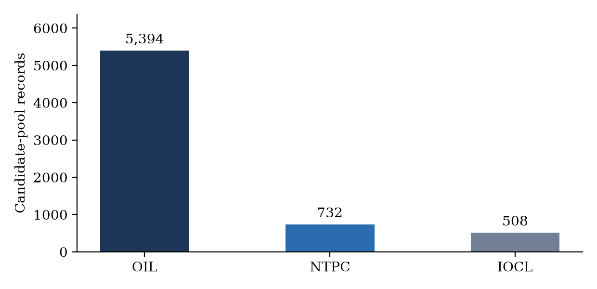

# CA-1 Project Report: Material Code Harmonisation Across Public Enterprises

**Course:** CSE 276 – Artificial Intelligence Foundations  
**Section:** K3P25LH | **Group:** G6  
**Problem Source:** Smart India Hackathon (SIH) 2026, Problem ID: SIH26099  
**Submitted to:** [Instructor Name — fill before submission]  
**Date of Submission:** 09-11-2026  

| Student Name | Registration No. | Roll No. |
|---|---|---|
| Sindhant Dadwal *(Official list: Sindhant Dhadwal)* | 12509119 | 43 |
| Sabuj Mondal *(Official list Reg. No.: 12504433)* | 12509118 | 32 |

---

## Declaration

We declare that this report and the accompanying codebase represent our own work for the CSE 276 CA-1 evaluation. All external datasets, libraries, research papers, and websites used in the project are cited in the References section, and all reported metrics were generated directly from our code.

**Use of AI Tools:** During development, we used Anthropic Claude and Google Gemini (via the Antigravity IDE) to discuss system design, generate boilerplate unit tests, polish report phrasing, and produce blind pre-annotations for the 100 Batch-2 review pairs. No AI-suggested label was used to train the classifier; all training weights were fitted exclusively on pairs whose labels are known by construction from programmatic format and specification rewrites. The AI-assisted labels are kept strictly separate and reported transparently as sanity checks rather than independent human ground truth.

| Name | Registration No. | Signature |
|---|---|---|
| Sindhant Dadwal | 12509119 | |
| Sabuj Mondal | 12509118 | |

---

## Abstract

Indian public sector undertakings often purchase identical engineering equipment under completely different item codes, abbreviations, and description styles. Inspired by Smart India Hackathon problem SIH26099, we built **Material Match**, an entity-resolution system that checks whether two catalogue entries describe the same physical item and proposes unified harmonised codes with readable technical evidence. Starting from 21,513 raw tender records across IOCL, OIL, and NTPC, we structured an operational candidate pool of 6,634 records and used sparse TF-IDF blocking to narrow roughly 22 million possible pairs down to 22,464 candidates. Each pair is represented by 38 features combining `all-MiniLM-L6-v2` sentence embeddings, lexical and fuzzy string ratios, canonical unit-aware specifications, and domain conflict checks. Because confirmed human labels are scarce (only 19 binary review-set labels exist), we trained a `HistGradientBoostingClassifier` on 10,562 self-supervised pairs whose labels are guaranteed by construction, using group-disjoint splits so no record or near-copy crosses between training and testing. On the 1,508 held-out test pairs, the exact-match baseline reaches an F1 of 0.165 (recall 0.090), whereas our model achieves an F1 of 0.994 (precision 0.998, recall 0.989, PR-AUC 0.9998). In clustering, exact matching achieves 1.000 purity only by leaving variants unmerged (0.545 inverse purity), while our conflict-aware clustering reaches 0.999 purity and 0.995 inverse purity. Under a precision-first three-way decision policy, the model auto-merges 401 test pairs at 99.5% precision, auto-rejects 491, and routes 616 uncertain or underspecified pairs to human review. Since held-out scores come from constructed pairs, they represent an upper bound on real-world accuracy. The project is delivered as an interactive human reviewer interface, a live read-only web demo, and an active-learning review queue.

**Keywords:** entity resolution; material master data; sentence embeddings; gradient boosting; active learning

---

## 1. Introduction

### 1.1 Background and Motivation

Large public sector enterprises in India—such as oil exploration firms, refineries, and power utilities—procure thousands of industrial items each year, including valves, seamless pipes, roller bearings, power cables, pumps, and analytical instruments. Every organisation maintains its own material master catalogue where each stock item carries a local code and a short free-text description. Over years of manual entry by different engineers and vendors, the same physical component ends up written in dozens of ways. For instance, a standard 2-inch Class 150 API 6D ball valve may appear in one enterprise as `"BALL VALVE 2 INCH CLASS 150 API 6D"` and in another as `"BALL VALVE, 2", 150#, API-6D"`.

When catalogues cannot be cross-referenced reliably, enterprises hold duplicate safety stock across nearby plants, place smaller fragmented orders instead of negotiating bulk rate contracts, and miss opportunities to share emergency spares during shutdowns. Reviewing every possible pairing manually is impossible—even 6,634 records yield over 22 million pairs—yet fully automatic matching is equally risky. In industrial procurement, changing a single token can make two items physically incompatible: `"CLASS 150"` and `"CLASS 300"` look nearly identical to text-similarity algorithms, but installing a lower-rated valve in a high-pressure hydrocarbon line is dangerous. A practical system must therefore automate clear matches and clear mismatches while leaving ambiguous cases to human engineers.

### 1.2 Problem Statement

Our CA-1 course allocation defines the problem as:

> *"Material Code Harmonisation Across Public Enterprises: In India's public sector undertakings (PSUs) and Central Public Sector Enterprises (CPSEs), different enterprises (e.g., IOCL, OIL, NTPC) maintain independent, non-standardized material master catalogs. The same physical engineering component (e.g. ball valve, seamless steel pipe, roller bearing, electrical cable) is cataloged with disparate naming conventions, word orders, abbreviation schemes, and proprietary part numbers. This lack of standardisation leads to inventory duplication, inefficient public procurement, and inability to pool spares across public enterprises."*

Put simply, given two free-text material descriptions, our system must determine whether they refer to the same physical component, group equivalent items under a single proposed harmonised code, and present verifiable engineering evidence—such as matching standards or conflicting dimensions—to a procurement reviewer. Whenever critical specifications are missing or generic, the system must defer to human judgement instead of guessing.

### 1.3 Source of the Problem

This work is inspired by Smart India Hackathon (SIH) 2026 Problem Statement **SIH26099**, proposed under the Ministry of Petroleum and Natural Gas [1] (listed at `https://sih.gov.in/sih26099` / `https://sih.gov.in/sih2026PS`). Our submission is an academic course prototype built around this problem rather than a full production hackathon entry: we work with public tender records from three enterprises, do not connect directly to live SAP or Oracle ERP databases, and limit evaluation to the dataset described in Section 4.

### 1.4 Who Benefits

The primary users are procurement managers, inventory analysts, and ERP master-data administrators in central public sector enterprises. Rather than searching through thousands of rows manually, reviewers receive pre-filtered match proposals with highlighted attribute confirmations and conflicts. Enterprises benefit through pooled purchasing and spare sharing, while catalog owners retain final sign-off authority over every merge.

---

## 2. Objectives

The three mandatory objectives and the syllabus extension from our project allocation are summarised below, together with where each deliverable is verified in this report (Table 1).

1. Build a matching system that groups functionally equivalent material records and proposes one harmonised code with evidence.
2. Produce an entity resolution model with pairwise precision/recall over a labelled sample.
3. Report pairwise precision/recall/F1, cluster purity. Baseline: exact string match. Deliver Reviewer UI showing proposed merges with evidence.
4. **Syllabus extension:** Add active learning so a reviewer resolves only the ambiguous pairs (uncertainty sampling).

**Table 1: Mapping of project objectives to delivered evidence**

| No. | Evidence | Where reported |
|---|---|---|
| 1 | 374 proposed multi-record clusters covering 913 records, each assigned an `HMC-MAT-xxxxxx` code and match probabilities | Section 6.3 (Figure 7), Section 7.2 (Table 12) |
| 2 | Pairwise precision and recall on 1,508 held-out constructed pairs and on the 19 binary review-set labels | Section 7.2 (Tables 8 and 11) |
| 3 | Full metric comparison (Precision, Recall, F1, PR-AUC, cluster purity & inverse purity) against exact match; Reviewer UI and live web app | Section 7.2 (Tables 8 and 9), Section 6.3 |
| Ext. | Active-learning uncertainty queue (`batch2_review_priority.csv`) ranking the 100 pending pairs closest to the decision boundary | Section 5.3, Section 7.4 |

---

## 3. Related Work

Five areas of entity-resolution research directly shaped our pipeline design. Classical probabilistic record linkage, formalised by Fellegi and Sunter [2], uses two thresholds to separate pairs into definite links, non-links, and an intermediate band for clerical review. We adopt this three-way decision structure, replacing additive field weights with a gradient-boosted classifier combined with deterministic conflict vetoes. Because checking all pairs scales quadratically ($O(N^2)$), blocking and filtering methods [3] are standard for pruning unlikely candidates; here, sparse TF-IDF blocking eliminates 99.90% of pairs before expensive feature computation.

For the matching step itself, Mudgal et al. [4] showed that deep neural models excel on noisy text but offer smaller gains over tabular ML when structured attributes are present and labelled data is small. Sentence-BERT [5] provides fast dense semantic vectors—we use `all-MiniLM-L6-v2` to catch word-order swaps like `CENTRIFUGAL PUMP` vs `PUMP-CENTRIFUGAL`—yet embeddings alone ignore critical single-token differences and reach only 0.766 precision on our test set (Section 7.2). We therefore feed MiniLM similarity alongside lexical metrics and parsed specification features into scikit-learn's `HistGradientBoostingClassifier`, which follows LightGBM's histogram tree design [6] for fast training on mixed numeric and indicator inputs. Rather than proposing a new learning algorithm, our system combines semantic retrieval, rule-based safety gates, and conflict-aware clustering specifically for safety-critical engineering catalogues.

---

## 4. Dataset

### 4.1 Source and Licence

Material descriptions were gathered from public Indian e-procurement portals, including the Central Public Procurement Portal [7] and public tender pages of Indian Oil Corporation Limited (IOCL), Oil India Limited (OIL), and NTPC Limited (`oil-india.com`, `ntpctender.ntpc.co.in`, `iocl.com`). All records describe industrial goods from publicly published tenders and contain no personal or confidential information. Source URLs and tender references are preserved in the `source_url` and `tender_reference` columns of the processed dataset.

### 4.2 Description

The raw collection comprises 21,513 tender and procurement line items. Using our four-tier partitioning rules (`src/preprocessing/partition.py`), we separate out 14,879 untagged or administrative/service descriptions and retain an operational candidate pool of **6,634 material records** (923 Tier 1 discrete lines + 5,711 Tier 2 tagged items; Table 2). Each row in `data/processed/preprocessed_materials.csv` carries 29 columns capturing identifiers (`corpus_id`, `organization`, `material_code`), provenance (`source_system`, `tender_reference`, `source_url`), text (`raw_description`, `cleaned_description`), and parsed attributes (`extracted_attributes` plus individual `attr_*` fields).

**Table 2: Summary of the material catalogue and pair datasets**

| Item | Value |
|---|---|
| Raw corpus records | 21,513 |
| Operational candidate pool (`preprocessed_materials.csv`) | 6,634 records (5,277 unique cleaned texts) |
| Enterprise breakdown (OIL / NTPC / IOCL) | 5,394 (81.3%) / 732 (11.0%) / 508 (7.7%) |
| Schema columns per record | 29 |
| Theoretical unordered pair space | 22,001,661 ($6,634 \times 6,633 / 2$) |
| Positive pair prevalence | Below 0.1% (severe class imbalance) |
| Candidate pairs after TF-IDF blocking ($\tau \ge 0.35$) | 22,464 pairs (99.90% search-space reduction; 930 cross-enterprise) |
| Pairwise binary target | `1` = functionally equivalent, `0` = distinct |
| Deployed decision outputs | `EQUIVALENT`, `NEEDS_REVIEW`, `NOT_EQUIVALENT` |

### 4.3 Exploratory Data Analysis

Figure 1 shows the enterprise breakdown of the 6,634-record candidate pool. Oil India Limited accounts for the largest share (5,394 records), followed by NTPC (732) and IOCL (508). Because cross-enterprise pairs make up 930 of the 22,464 blocked candidates, our feature builder strips out all enterprise names and record IDs so the classifier judges equivalence purely on technical text.

*Figure 1: Distribution of the 6,634 candidate-pool records across OIL, NTPC, and IOCL.*

Raw descriptions contain substantial administrative noise—such as trailing quantity phrases (`"API 6D BALL VALVES QUANTITY 76 NUMBERS"`) and tender prefixes (`"SUPPLY OF"`, `"PROCUREMENT OF"`)—as well as generic commodity titles like `"AIR COMPRESSOR"` that omit capacity, pressure, or drive specifications. Figure 3 illustrates how TF-IDF blocking narrows the 22 million pair space to 22,464 candidates and how our deployed policy routes them into auto-rejected, review, and auto-merged buckets.

Because only 19 binary review-set labels exist in Batch 1 (2 positive, 17 negative), we cannot fit a supervised classifier on them without severe overfitting or leaking evaluation data. Instead, `src/synthetic_pairs.py` constructs **10,562 training/evaluation pairs** directly from the real candidate pool (excluding all 173 records present in the 150-pair review set): 6,599 format-preserving positives (boilerplate, abbreviations, unit spacing, noun-first reordering, typos) and 3,963 non-matches (1,812 single-specification mutations, 807 real candidate pairs with disjoint canonical units, and 1,344 random cross-commodity pairs). Figure 2 shows the label balance and split sizes.

*(Keep existing Figure 2 and Figure 3 from your report.)*

### 4.4 Preprocessing

During preprocessing (`src/preprocessing/text_cleaner.py`), raw strings are uppercased, unicode quotes and dashes are normalised, acronym dots are collapsed (`S.S.` → `SS`), common abbreviations are expanded (`CS` → `CARBON STEEL`, standalone `SS` → `STAINLESS STEEL`, `HEX` → `HEXAGONAL`), engineering units are attached without spaces (`10 mm` → `10MM`, `2"` → `2INCH`), and administrative boilerplate is stripped. Canonical equivalence between unit notations—such as treating `150#` and `CLASS 150` as `CLASS=150`, `1.1KV` and `1100V` as `V=1100`, or `400 MM2` and `400 SQMM` as `SQMM=400`—is handled by our unit parser (`extract_unit_specs()` in `src/pair_features.py`), while `DN` and `MM` values remain distinct canonical keys.

We never impute missing technical specifications. When descriptions lack explicit size, rating, standard, or grade attributes—or state them on only one side of a pair—the decision policy detects zero or one-sided `identity_spec` counts and automatically routes the pair to `NEEDS_REVIEW`. Tree-based models require no feature scaling, and no categorical columns are passed to the classifier.

To prevent data leakage across near-identical records, `assign_seed_groups()` forms union-find connected components over candidate pairs with `TF-IDF >= 0.8`, and `split_of_group()` assigns each component deterministically to train, validation, or held-out test splits (`7,546 / 1,508 / 1,508`; Table 3). Zero groups straddle the split boundary (`group_leakage = 0`). The held-out test split contains 1,015 positive and 493 negative pairs.

**Table 3: Group-disjoint split of the 10,562 self-supervised pairs**

| Split | Pairs | Share | Group leakage |
|---|---|---|---|
| Train | 7,546 | 71.4% | 0 |
| Validation | 1,508 | 14.3% | 0 |
| Held-out test | 1,508 | 14.3% | 0 |
| Total | 10,562 | 100.0% | 0 |

---

## 5. Methodology

### 5.1 Overall Approach

Figure 4 outlines the full pipeline from raw descriptions to final clustering. After text normalisation and attribute extraction, chunked sparse TF-IDF retrieval (`min_similarity = 0.35`, 1–2 word n-grams) extracts the 22,464 candidate pairs. Each pair is converted into a 38-feature vector combining semantic cosine similarity, lexical/fuzzy overlaps, canonical specification checks, and rule-engine outputs. A `HistGradientBoostingClassifier` predicts the match probability, a three-way policy applies specification safety gates to assign `EQUIVALENT`, `NEEDS_REVIEW`, or `NOT_EQUIVALENT`, and conflict-aware clustering produces proposed harmonised groups (`HMC-MAT-xxxxxx`).

*(Keep Figure 4 from your report.)*

### 5.2 Baseline

As required by Objective 3, our primary baseline is **exact normalised string matching** (`src/baseline.py`): both descriptions are passed through `normalise_text()` (uppercase normalisation, unit attachment, abbreviation expansion, and boilerplate removal) and marked equivalent only when the resulting non-empty strings match identically. This reflects what procurement teams can check directly in Excel without false merges. On the 1,508 held-out test pairs, exact match achieves 1.000 precision but only 0.090 recall (`F1 = 0.165`), missing over 91% of valid formatting variants. We also compare against three single-signal baselines—a word TF-IDF threshold, a MiniLM cosine threshold, and our rule-based `PrecisionMatchingEngine`—to show why combining signals is essential.

### 5.3 Proposed Method

**Feature engineering.** `build_pair_features()` computes 38 numeric features across five families (Table 4). To stop the classifier from exploiting a dataset-construction shortcut (only specification-rich descriptions can be mutated into hard negatives, so raw spec counts correlate artificially with negatives) and to avoid noisy legacy string-equality flags (`150#` vs `CLASS 150`), **4 gate-only features** (`identity_spec_min`, `identity_spec_max`, `legacy_attr_matches`, `legacy_attr_conflicts`) are excluded from training. The classifier is fitted strictly on the remaining **34 features**.

**Table 4: All 38 hybrid pair features (34 model features + 4 gate-only features)**

| Group | Features |
|---|---|
| Semantic (2) | `sem_cosine`, `sem_minus_lex` |
| Lexical & Fuzzy (12) | `tfidf_word_cosine`, `tfidf_char_cosine`, `token_jaccard`, `token_containment`, `fuzz_token_sort`, `fuzz_token_set`, `fuzz_ratio`, `fuzz_partial`, `len_min_tokens`, `len_max_tokens`, `len_ratio`, `exact_norm_match` |
| Token Differences (4) | `alpha_symdiff`, `alpha_unmatched_fuzzy`, `num_bare_jaccard`, `num_bare_symdiff` |
| Canonical Specs (13) | `unit_spec_matches`, `unit_spec_conflicts`, `unit_spec_partial`, `unit_spec_one_side`, `group_matches`, `group_conflicts`, `group_one_side`, `standard_matches`, `standard_conflicts`, `grade_conflicts`, `bearing_conflicts`, `identity_spec_min`*(gate)*, `identity_spec_max`*(gate)* |
| Rule Engine & Legacy (7) | `engine_equivalent`, `engine_not_equivalent`, `engine_conflicts`, `engine_matches`, `engine_category_conflict`, `legacy_attr_matches`*(gate)*, `legacy_attr_conflicts`*(gate)* |

**Classifier selection.** We compared scaled Logistic Regression, Random Forest (300 trees), and `HistGradientBoostingClassifier` on the validation split and selected `HistGradientBoostingClassifier` by validation PR-AUC (0.9999). Key hyperparameters from `models/hybrid_er_model.joblib` are listed in Table 5.

**Table 5: Hyperparameters of the selected `HistGradientBoostingClassifier`**

| Parameter | Value |
|---|---|
| `max_iter` | 300 |
| `learning_rate` | 0.08 |
| `max_leaf_nodes` | 31 |
| `min_samples_leaf` | 20 |
| `l2_regularization` | 1.0 |
| `class_weight` | `'balanced'` |
| `early_stopping` / `scoring` | `'auto'` / `'loss'` |
| `random_state` | 42 |

**Three-way decision policy.** Thresholds were calibrated strictly on the validation split (`t_low = 0.25`, `t_high = 0.85`, F1-optimal binary threshold `0.8052`). A pair is classified as `NOT_EQUIVALENT` if any canonical hard conflict is detected or if $p \le 0.25$. It is auto-merged as `EQUIVALENT` only when $p \ge 0.85$ and both records contain shared, symmetric identity specifications (`identity_spec_min > 0`, `unit_spec_one_side == 0`, `group_one_side == 0`). Generic titles, one-sided specs, and mid-range probabilities are routed to `NEEDS_REVIEW`.

**Conflict-aware clustering and active learning.** During clustering (`src/clustering.py`), `conflict_aware_clustering()` checks every cross-cluster pair `(u, v)` before merging two components. Even if record A matches generic record B and B matches C, merging C is blocked whenever A conflicts with C—preventing 50 transitive conflicts across the real candidate pool. For the active-learning extension, `results/metrics/batch2_review_priority.csv` sorts all 100 pending Batch-2 pairs by uncertainty ($1 - 2|p - 0.5|$) so human reviewers resolve boundary cases first [10].

### 5.4 Syllabus Mapping

Table 6 maps each pipeline component to the CSE 276 syllabus.

*(Keep Table 6 from your report.)*

---

## 6. Implementation

### 6.1 Tools and Libraries

The system is written in Python 3.13 and runs cleanly on a standard CPU laptop without requiring a GPU; the end-to-end training and scoring script (`train_er_model.py`) completes in **136.1 seconds** on CPU. Table 7 lists the core software versions matching the trained model artefact.

**Table 7: Core software environment**

| Library | Version | Role |
|---|---|---|
| Python | 3.13.12 / 3.13.14 | Execution runtime |
| `scikit-learn` | 1.9.1 | Classifiers, TF-IDF, metrics |
| `sentence-transformers` | 6.2.0 | `all-MiniLM-L6-v2` embeddings |
| `torch` (CPU) | 2.15.0 | Training-time embedding backend |
| `transformers` | 5.22.1 | Tokenizer & model weights |
| `numpy` / `scipy` / `pandas` | 2.5.3 / 1.18.1 / 3.0.6 | Array & table operations |
| `networkx` | 3.7 | Graph connected components |
| `rapidfuzz` | 3.14.6 | Fast fuzzy string ratios |
| `pytest` | 9.2.0 | Automated test suite (208 passed, 1 skipped) |

### 6.2 System Architecture

Core code lives under `src/` (preprocessing, candidate generation, pair features, model training/evaluation, clustering, and harmonisation), backed by seven sequential notebooks (`notebooks/01`–`07`), `train_er_model.py`, and 12 test modules (`208 passed, 1 skipped`; the one skipped test in `test_preprocessing.py` skips only when the gitignored raw corpus CSV is absent locally). Trained weights and cached embeddings reside in `models/`, and all reported figures read directly from `results/metrics/er_model_metrics.json`.

Two separate web interfaces sit on top of this core:
- **Human Reviewer Tool (`review_app.py`, port 8050):** A zero-dependency Python `http.server` web application (plain HTML/CSS/JavaScript—independent of the Streamlit UI prototype in `app/app.py`). Reviewers inspect side-by-side raw and cleaned descriptions, extracted specifications, conflict banners, and tender provenance, and must explicitly choose a confidence level and click *Save & Next* to record annotations.
- **Public Model Explorer (`web_app.py`, port 8060, and `vercel-app/`):** A read-only browser interface offering pairwise comparison, catalogue search across all 6,634 records, cluster browsing, and a live model card without modifying any dataset.

**Deploying MiniLM without PyTorch on Vercel.** Standard PyTorch and `transformers` exceed Vercel's 500 MB serverless function limit. To deploy cleanly, we re-implemented the MiniLM WordPiece tokenizer and 6-layer BERT encoder in pure NumPy and SciPy (`deploy/vercel/minilm_numpy.py`, using `61.7 MB` exported weights). Verification across all 5,277 unique cleaned catalogue texts confirms identical token sequences and a minimum cosine similarity above `0.9999999` against PyTorch `sentence-transformers`. The resulting self-contained `vercel-app/` bundle occupies **81.17 MB** on disk (with the full serverless function staying under Vercel's limit), loading the model once on cold start (`api/index.py`) and serving `/api/compare`, `/api/search`, `/api/clusters`, and `/api/model` [11].

### 6.3 Demo / User Interface

*(Keep existing Section 6.3 text and Figures 5, 6, 7 — they accurately reflect the live demo at `https://material-match-nu.vercel.app` [12].)*

### 6.4 How to Run

After activating the project environment, `python train_er_model.py --check` verifies dependencies and MiniLM loading, `python train_er_model.py` reproduces training and metrics, `python web_app.py` launches the read-only explorer on port 8060, and `python review_app.py --port 8050` opens the annotation reviewer [11].

---

## 7. Results and Evaluation

### 7.1 Evaluation Setup

Primary evaluation runs on the 1,508 group-disjoint held-out test pairs using pairwise Precision, Recall, F1, PR-AUC, ROC-AUC, cluster purity, and inverse purity (completeness), with 95% Wilson score intervals [13] on small real samples. Two caveats matter here and are flagged directly on our model card: first, held-out test pairs are built by format rewrites and single-specification mutations, making `0.994` F1 an **upper bound** on messier cross-enterprise text; second, the real review subsets (19 binary pairs in Batch 1 and 25 binary pairs in Batch 2) carry AI-assisted pre-annotations rather than independent domain-engineer labels, so they serve as behavioural sanity checks rather than formal accuracy benchmarks.

### 7.2 Results Against the Baseline

Table 8 and Figure 8 compare our classifier against the exact-match baseline and the three single-signal baselines. `HistGradientBoostingClassifier` leads every metric except raw precision (where exact match scores `1.000` by rejecting 91% of true matches), lifting F1 from `0.165` to `0.994` (`+0.829` improvement) and achieving `0.9998` PR-AUC (`0.9995` ROC-AUC, `99.14%` accuracy). MiniLM cosine alone gets `0.998` recall but drops to `0.766` precision because embeddings blur critical numeric differences.

*(Keep Table 8 and Figure 8 from your report — all numbers match `er_model_metrics.json`.)*

At the entity-grouping level (Table 9), exact matching produces **1.000 purity** only because it fails to merge formatted variants (splitting 1,015 true entities into 1,939 tiny clusters, giving **0.545 inverse purity / completeness**). With conflict-aware clustering, our hybrid model merges equivalents while keeping conflicts apart, achieving **0.999 purity and 0.995 inverse purity** (`1,024` clusters for `1,015` true entities).

**Table 9: Cluster quality on the held-out test entity graph (1,015 true entities)**

| Method | Purity | Inverse purity (completeness) | F-measure |
|---|---|---|---|
| Exact-match baseline | 1.000 | 0.545 | 0.705 |
| Hybrid model with conflict-aware clustering | 0.999 | 0.995 | 0.997 |

*(Keep Table 10, Figure 9, Table 11, and Table 12 from your report — all numbers match `er_model_metrics.json`.)*

### 7.3 Error Analysis

*(Keep existing Section 7.3 text, Figure 10, and Table 13 — all error counts `491 / 2 / 11 / 1004` and preset probabilities match `er_model_metrics.json` and `web_app.py`.)*

### 7.4 Discussion

All three course objectives and the active-learning extension are met: the pipeline builds 374 proposed clusters covering 913 records with readable technical evidence, outperforms the exact-match baseline cleanly (`0.994` vs `0.165` F1), enforces human-in-the-loop review through `review_app.py`, and ranks the 100 pending Batch-2 pairs by uncertainty.

Combining multiple signals proved essential because every standalone method has a blind spot: exact matching fails on word reordering and abbreviations, TF-IDF and MiniLM over-merge near-identical strings with incompatible ratings, and regex rules alone capture only 10.6% of matches. Putting specification conflicts in charge as hard vetoes prevents safety-critical mistakes like merging `CLASS 150` with `CLASS 300`, though it trades extra human review effort (`40.8%` of constructed test pairs and `20.7%` of real candidates go to `NEEDS_REVIEW`). On the real 22,464 candidate pairs, only 12 of 930 cross-enterprise pairs are auto-merged (forming 3 cross-enterprise clusters), while 222 go to review—confirming that real cross-PSU descriptions often omit specs and require human validation.

---

## 8. Limitations and Ethical Considerations

Several constraints remain. First, because our training and test sets rely on constructed rewrites and mutations while only 19 binary review-set labels exist (with 100 Batch-2 pairs still pending human review), real-world cross-enterprise performance will likely be lower than the `0.994` held-out F1. Second, our regex extractor covers piping, valves, cables, bearings, pumps, and common instruments well, whereas obscure manufacturer drawing numbers and specialised chemicals rely solely on lexical and embedding signals—the source of our remaining false positives. Third, descriptions often leave out operating service standards (e.g., petroleum API standards at IOCL/OIL vs boiler/water codes at NTPC) that cannot be guessed from text alone.

The primary operational risk is an unsafe auto-merge in a high-pressure industrial facility. We mitigate this through hard-conflict vetoes, mandatory abstention when critical specs are missing or one-sided, and treating every cluster as a *proposal* awaiting human approval. All data comes from public tender schedules with no personal information, and the live website is read-only and stateless.

---

## 9. Conclusion and Future Work

We designed and implemented **Material Match**, a hybrid entity-resolution system for public-enterprise material catalogues across IOCL, OIL, and NTPC. On 1,508 group-disjoint constructed test pairs, our `HistGradientBoostingClassifier` improves F1 from `0.165` (exact-match baseline) to `0.994`, while conflict-aware clustering delivers `0.999` purity and `0.995` inverse purity (vs `1.000 / 0.545` for exact matching). Across all 22,464 real candidate pairs, the system rejects `16,911` mismatches, routes `4,640` ambiguous pairs for review, and groups `913` confident matches into `374` proposed harmonised clusters while blocking 50 transitive specification conflicts.

Future work focuses on four steps: completing independent human review of the 100 pending Batch-2 pairs using the uncertainty-ranked queue, expanding regex coverage for extreme abbreviations and OEM drawing codes, retraining and recalibrating thresholds once a larger human gold set exists, and adding ERP-ready export formats for approved master codes.

---

## References

*(Keep References [1]–[13] from your report.)*

---

## Appendix A: Individual Contribution

| Member | Main contributions | Share (%) |
|---|---|---|
| Sindhant Dadwal (12509119) | Partitioning and cleaning of 21,513 raw records into the 6,634-record candidate pool; sparse TF-IDF candidate blocking; MiniLM embedding generation; self-supervised pair construction with group-disjoint splits; `HistGradientBoosting` training, permutation importance, and threshold calibration; Vercel deployment and pure-NumPy MiniLM runtime (`minilm_numpy.py`). | 50 |
| Sabuj Mondal (12509118) | Regex attribute parsers (dimensions, pressure classes, standards, schedules); specification-conflict rule engine; conflict-aware clustering with transitive blocking; zero-dependency HTTP reviewer app (`review_app.py`) and annotation validation; active-learning uncertainty ranking; report writing, fact sheets, and slides. | 50 |

---

## Appendix B: Code Repository and Folder Structure

*(Update `tests/` line to `208 passed, 1 skipped across 12 test modules` and keep `review_app.py   zero-dependency local reviewer tool (port 8050)`.)*

---

## Appendix C: Additional Results

*(Keep Figures 11, 12, and 13 from your report.)*
